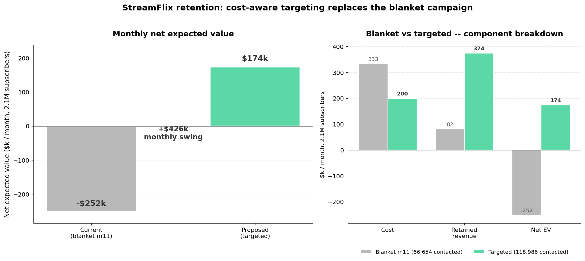

# 💸 StreamFlix Subscriber Retention — Cost-Aware Churn Targeting

[](https://janeruxi1-streamflix-churn-retention.streamlit.app/)


> **Cost-aware customer-retention system** for a fictional streaming subscription business (synthetic data with realistic churn bands, tenure spikes, engagement cohorts and an intervention menu). End-to-end: a calibrated churn model, a budget-constrained intervention policy, a randomized experiment, and a deployed decision-support tool. Sister project to [`StreamFlix-AB-Testing`](https://github.com/janeruxi1/StreamFlix-AB-Testing) and [`StreamFlix-RAG-evaluation`](https://github.com/janeruxi1/StreamFlix-RAG-evaluation), built on the same StreamFlix context.



**Bottom line** (per month, full 2.1M base, $200k budget): the blanket $5-credit campaign loses **$252k**. The targeted policy earns **+$174k** net expected value at 1.87× ROI, a **$426k monthly swing** on $133k less spend. A randomized holdout confirms the $5 credit works on average (12.6% of would-be churners retained), but an uplift model trained on it ranks users no better than chance, so the propensity-based policy ships and the uplift model doesn't. Synthetic data with assumed lever uplifts; see [Limitations](#️-limitations--threats-to-validity). Recommendation in [`reports/decision_memo.md`](./reports/decision_memo.md).

**Fastest way in:** [`reports/PROJECT_SUMMARY.md`](./reports/PROJECT_SUMMARY.md) — one-page catalog of the three parts (churn model → decision rule → experiment and uplift test), with every headline number traced to its source notebook.

---

## 📌 Business Problem

StreamFlix runs a paid streaming subscription with ~2.1M monthly subscribers and ~5.3% monthly churn. The Retention team currently runs a blanket $5-credit campaign every month at month-11 — expensive, untargeted, and without ROI measurement.

The PM wants to **replace the blanket campaign with a cost-aware targeting system** that, for each subscriber:

1. Predicts the probability they will churn in the next 30 days
2. Recommends the cheapest intervention expected to retain them
3. Decides whether to engage at all, given a fixed monthly budget

Full PM brief: [`reports/scenario_brief.md`](./reports/scenario_brief.md)
Metric framework: [`reports/metrics_framework.md`](./reports/metrics_framework.md)

---

## ⚠️ Limitations & threats to validity

Read these before the headline numbers:

- **Synthetic data.** Every result comes from a simulator, and the policy head-to-head is scored against its own ground truth (`true_uplift`). That shows the methods work on a known answer, not that they would lift real revenue.
- **Assumed uplifts.** Only the $5 credit has (simulated) experimental data. The playlist (5%) and Premium-upgrade (25%) uplifts are planning assumptions, and playlists make up 85% of contacts, so the ROI of 1.87× depends on them.
- **Snapshot data, random validation.** LTV comes from survival curves built on one snapshot (it assumes stable monthly churn rates), and the model split is a stratified random 60/20/20 with no out-of-time test.
- **Model uncertainty.** On a 10k-row test set with 534 churners, PR-AUC is 0.177 against a 0.053 base rate, with a bootstrap 95% interval of about ±0.03 ([`reports/metric_confidence_intervals.md`](./reports/metric_confidence_intervals.md)). Logistic regression, XGBoost and the shipped HistGBM are statistically tied.
- **Targets missed.** ROI is 1.87× against a 2.0× kickoff target (reached at ≤ $150k budget), and ~72% of spend goes to subscribers who would not have churned (guardrail: < 30%). The memo discusses both.
- **Next step:** validate on real data, and A/B test each lever before trusting the uplift assumptions.

---

## 🧭 Where things are

| Want to see… | Go to |
|---|---|
| One-page catalog of the whole project | [`reports/PROJECT_SUMMARY.md`](./reports/PROJECT_SUMMARY.md) |
| Recommendation to stakeholders | [`reports/decision_memo.md`](./reports/decision_memo.md) |
| Metric confidence intervals | [`reports/metric_confidence_intervals.md`](./reports/metric_confidence_intervals.md) |
| Project structure, MLflow/Registry, testing, roadmap, method choices | [`docs/DETAILS.md`](./docs/DETAILS.md) |
| Dataset schema & ground truth | [`data/README.md`](./data/README.md) |

## 🚀 Quick start

```bash
pip install -r requirements.txt
python src/data/simulate.py              # generate both CSVs
python notebooks/04_modeling.py          # train + persist churn model
python notebooks/08_uplift_modeling.py   # train + persist uplift model
python scripts/bootstrap_churn_ci.py     # metric confidence intervals
pytest tests/ && ruff check src tests scripts   # 93 tests
streamlit run app/streamlit_app.py       # decision-support app
```

MLflow runs are stored in a local `mlflow.db` (git-ignored; created when you run the notebooks).

## 📫 Author

Xi Ru · [LinkedIn](https://www.linkedin.com/in/xiru) · [Email](mailto:ruthruxi@gmail.com)
